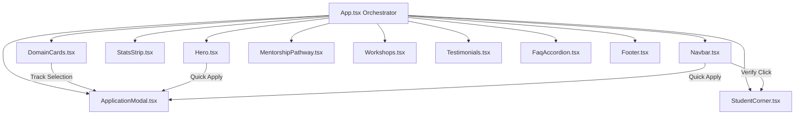

# Architecture Documentation — InternNova Redesign

## 1. Frontend Architecture Overview
The application follows a modular, component-driven client architecture designed for sub-second initial load, zero cumulative layout shifts (CLS), and fluid responsiveness from 360px up to 4K displays.

```
internnova/
├── docs/
│   ├── PRD.md                 # Product Requirements Document
│   ├── architecture.md        # Technical architecture & state management
│   ├── rule.md                # Code governance, responsive rules & boundaries
│   └── memory.md              # Decision log & milestone progress tracking
├── public/
│   └── favicon.svg            # Branded SVG vector favicon
├── src/
│   ├── components/            # Discrete atomic & section components
│   │   ├── Navbar.tsx         # Sticky navigation with mobile drawer & fast action triggers
│   │   ├── Hero.tsx           # Value proposition, live cohort pill, trust ticker
│   │   ├── StatsStrip.tsx     # Metrics counter cards with group-hover accents
│   │   ├── DomainCards.tsx    # Filterable catalog, real-time search, syllabus modal
│   │   ├── MentorshipPathway.tsx # 4-stage sprint roadmap & methodology comparison
│   │   ├── StudentCorner.tsx  # Verifier, ATS keyword scorer, public portfolio hub
│   │   ├── Workshops.tsx      # Announcement cards & interactive pass reservation
│   │   ├── Testimonials.tsx   # Domain-filtered paginated review carousel
│   │   ├── FaqAccordion.tsx   # Accessible collapsible Q&A items
│   │   ├── ApplicationModal.tsx# Multi-track application modal with validation
│   │   └── Footer.tsx         # Pre-footer banner, newsletter with validation, MSME badge
│   ├── data/
│   │   └── mockData.ts        # Strongly typed datasets (domains, reviews, FAQs, certs)
│   ├── App.tsx                # Layout composition & global modal state orchestration
│   ├── index.css              # Tailwind CSS v4 directives & glassmorphic tokens
│   └── main.tsx               # Application entry point
├── index.html                 # Semantic HTML5, Google Fonts & SEO metadata
├── vite.config.ts             # Vite 8 + React + Tailwind v4 plugin pipeline
└── package.json
```

---

## 2. Tech Stack & Dependencies

- **Framework:** React 19 + TypeScript (Strict mode enabled, verbatim module syntax compliant)
- **Bundler:** Vite 8 (Hot Module Replacement, fast production builds)
- **Styling:** Tailwind CSS v4 with custom utility tokens (`@import "tailwindcss"`)
- **Typography:** Plus Jakarta Sans & Inter via Google Fonts
- **Icons:** `lucide-react` (Lightweight tree-shakeable SVG vector icons)
- **State Management:** React local state (`useState`, `useMemo`, `useEffect`) avoiding bloated global state overhead.

---

## 3. Key Design System Tokens (DESIGN.MD Compliance)

- **Dark Mode Palette:**
  - Background Base: `#07090E`
  - Secondary Base: `#0A0F1D` / `#0F172A`
  - Primary Accent: `#7C3AED` (Violet)
  - Secondary Accent: `#06B6D4` (Cyan)
  - Primary Text: `#F8FAFC`
  - Muted Text: `#94A3B8` / `#CBD5E1`
- **Glassmorphic Tokens:**
  - Background: `rgba(15, 23, 42, 0.7)` with `backdrop-filter: blur(16px)`
  - Borders: `1px solid rgba(255, 255, 255, 0.08)`
  - Active Glows: `rgba(124, 58, 237, 0.25)` and `rgba(6, 182, 212, 0.25)`

---

## 4. State Flow & Interactivity


